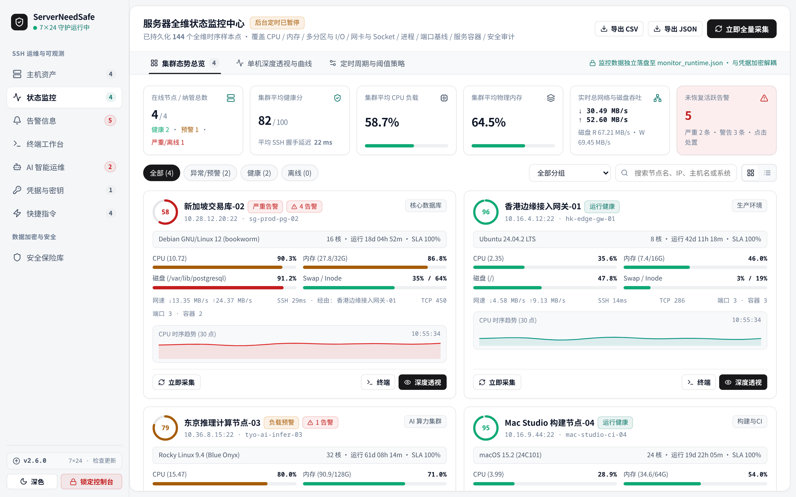
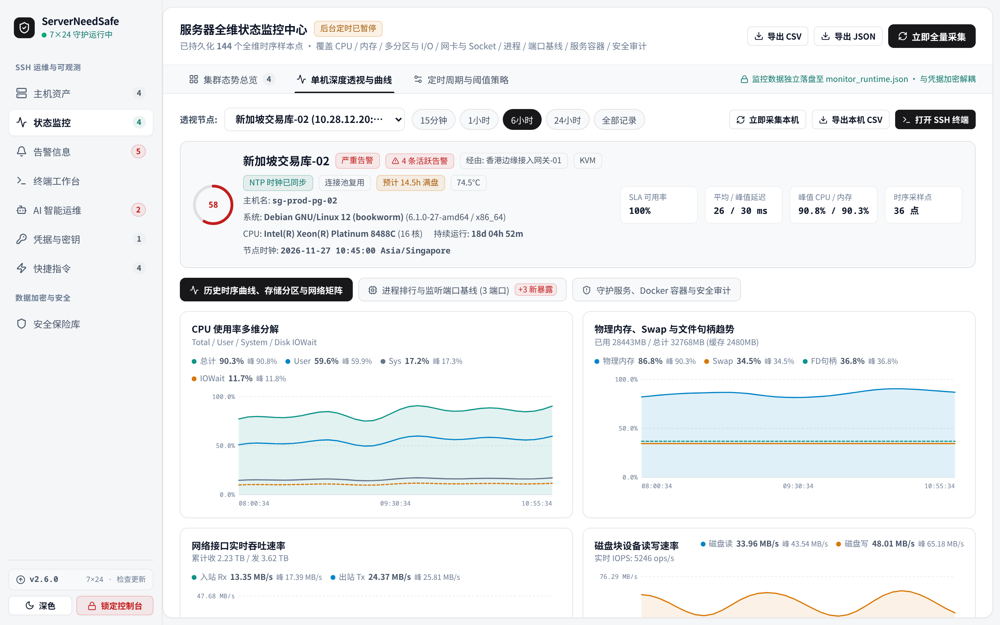
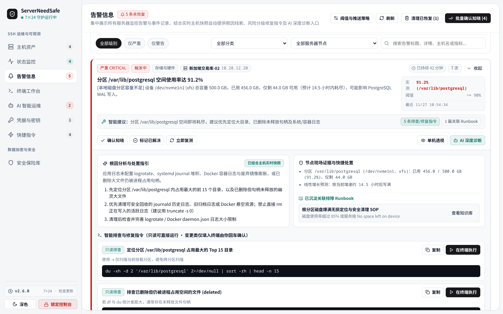
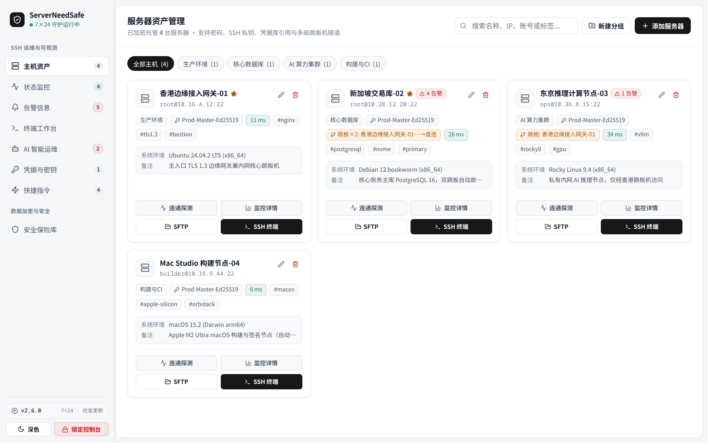
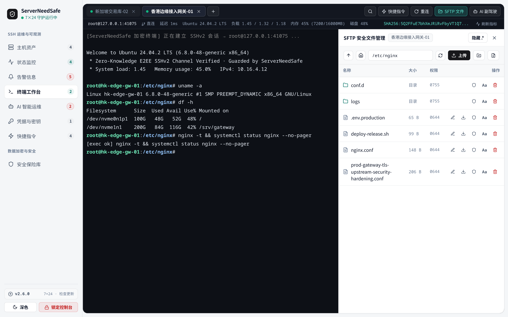
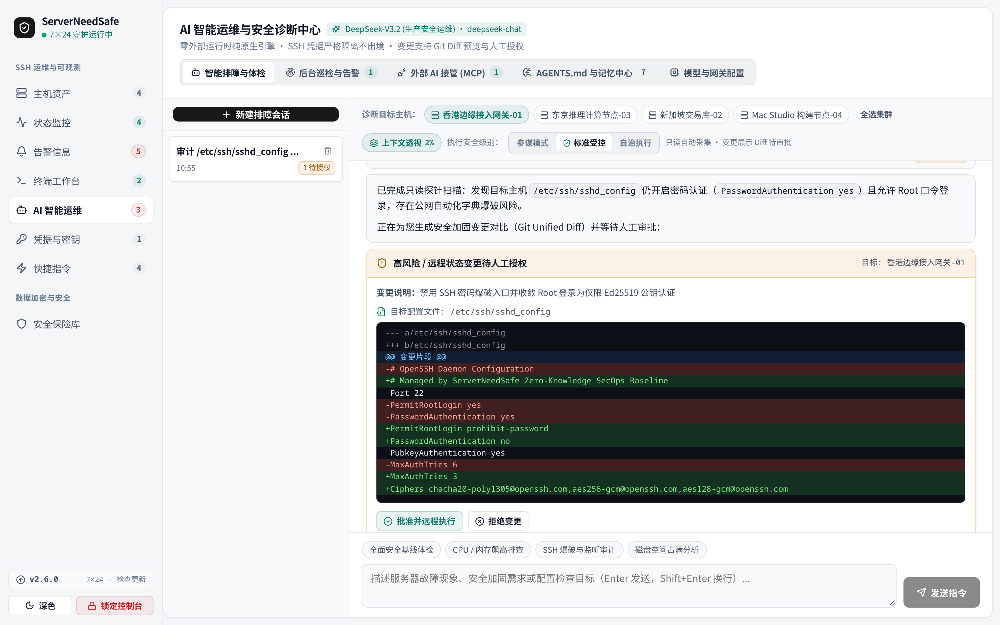
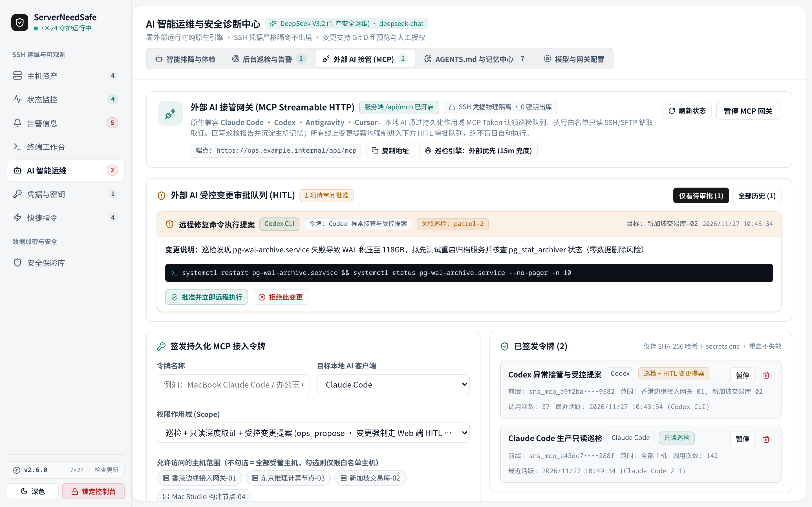
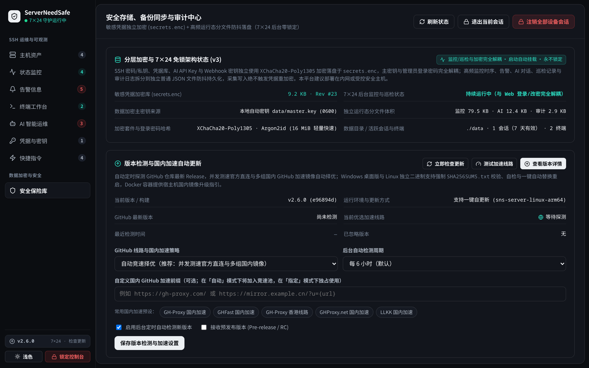
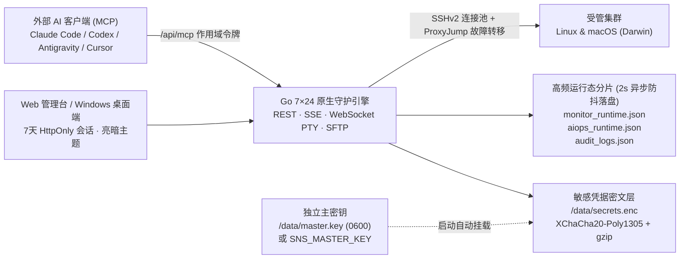

<div align="center">

# ServerNeedSafe

**面向 Vibe Coding 时代的 7×24 全天候多服务器安全管理、无 Agent 状态监控与 AI 智能运维平台**

[](https://github.com/icaruszezen/ServerNeedSafe/actions/workflows/build-release.yml)
[](https://github.com/icaruszezen/ServerNeedSafe/releases/latest)
[](go.mod)
[](Dockerfile)
[](https://github.com/icaruszezen/ServerNeedSafe/releases)
[](#内置-mcp-网关与外部-ai-接管)

<p>
  <a href="#运行界面预览">界面预览</a> ·
  <a href="#核心功能全景">核心功能</a> ·
  <a href="#分层加密与免锁存储架构">存储架构</a> ·
  <a href="#部署与运行指南">快速部署</a> ·
  <a href="#内置-mcp-网关与外部-ai-接管">MCP 接入</a> ·
  <a href="#目录架构与开发构建">开发构建</a> ·
  <a href="CHANGELOG.md">更新日志</a>
</p>

<br />

<picture>
  <source media="(prefers-color-scheme: dark)" srcset="docs/screenshots/01-monitor-overview-dark.png" />
  <source media="(prefers-color-scheme: light)" srcset="docs/screenshots/01-monitor-overview.png" />
  
</picture>

<sub>自动适配 GitHub 深/浅色模式 · 原生 Go 7×24 守护引擎 + 轻量 React Web 管理台（支持亮/暗双主题与移动端自适应）</sub>

</div>

---

## 为什么选择 ServerNeedSafe？

`ServerNeedSafe` 采用 **单一原生 Go 后台守护引擎（`CGO_ENABLED=0`）+ 内嵌轻量前端** 架构，零外部数据库依赖，一套代码同时交付 **Docker / Linux 7×24 服务端** 与 **Windows 纯本地独立桌面应用** 两种形态：

- **7×24 永不锁死的守护引擎**：静态数据加密主密钥（`master.key` / `SNS_MASTER_KEY`）与 Web 管理员登录口令彻底解耦。容器或进程重启 `<1ms` 自动就绪，退出登录、会话到期或在线改密均**绝不中断**后台监控采集、告警推送与 AI 定时巡检。
- **凭据密文与高频运行态彻底隔离**：SSH 密码/私钥、凭据库、AI API Key、Webhook 与 MCP 令牌哈希使用 `XChaCha20-Poly1305` 加密写入 `secrets.enc`；高频监控时序、告警事件、AI 会话记忆与审计日志异步防抖落盘至独立 JSON 文件，零锁阻塞、零重加密开销。
- **清爽低摩擦的安全体验**：Web 管理台默认保持 **7 天（`168h`）** `HttpOnly; SameSite=Lax` 登录会话（支持 `Ctrl+Shift+L` 一键锁屏与 5 次输错防爆破冷却），原生兼容 Nginx/Caddy 反向代理与内网直连。

> [!TIP]
> **部署定位建议**：本项目面向**个人及团队内网机器、VPN / WireGuard 私有网络，或已配置 HTTPS 与防火墙加固的受控宿主机**，优先保障 7×24 运维稳定性、单文件跨平台便携性与静态凭据加密，而非面向不可信多租户公网环境对抗。

---

## 运行界面预览

> 以下全部截图均由最新版本实时运行环境截取（点击任意图片可查看原尺寸高清图）。

<table>
  <tr>
    <td width="50%" align="center">
      <a href="docs/screenshots/01-monitor-overview.png">
        
      </a>
      <br />
      <strong>7×24 状态监控 · 集群态势总览</strong><br />
      <sub>全网 KPI 仪表盘、健康分、Linux/macOS 多节点卡片与实时 CPU 趋势</sub>
    </td>
    <td width="50%" align="center">
      <a href="docs/screenshots/02-monitor-detail.png">
        
      </a>
      <br />
      <strong>单机深度透视 · 多维 SVG 时序曲线</strong><br />
      <sub>CPU 多维分解、内存/句柄、磁盘预测满盘时长、IOPS 与网络吞吐</sub>
    </td>
  </tr>
  <tr>
    <td width="50%" align="center">
      <a href="docs/screenshots/03-alert-center.png">
        
      </a>
      <br />
      <strong>独立告警中心 · 智能修复建议引擎</strong><br />
      <sub>覆盖 34 类内置规则，结合实时快照给出根因、证据、只读/变更分级指令与 AI 诊断</sub>
    </td>
    <td width="50%" align="center">
      <a href="docs/screenshots/04-servers-assets.png">
        
      </a>
      <br />
      <strong>多服务器资产 · 多级跳板故障转移</strong><br />
      <sub>分组/星标/多维检索、候选跳板机自动故障转移链、跨平台识别与告警直达</sub>
    </td>
  </tr>
  <tr>
    <td width="50%" align="center">
      <a href="docs/screenshots/05-terminal-sftp.png">
        
      </a>
      <br />
      <strong>多标签 WebSocket 终端 + 同屏 SFTP</strong><br />
      <sub>基于 Xterm.js 的原生二进制 PTY 终端，同屏流式 SFTP 浏览、编辑与传输</sub>
    </td>
    <td width="50%" align="center">
      <a href="docs/screenshots/06-aiops-hitl.png">
        
      </a>
      <br />
      <strong>AI 智能运维 · HITL Unified Diff 审批</strong><br />
      <sub>流式 ReAct 只读取证、上下文透视与配置文件修改 Git Diff 逐行审批</sub>
    </td>
  </tr>
  <tr>
    <td width="50%" align="center">
      <a href="docs/screenshots/07-aiops-mcp.png">
        
      </a>
      <br />
      <strong>内置 MCP 网关 · 外部 AI 接管巡检</strong><br />
      <sub>支持 Claude Code / Codex / Antigravity / Cursor，作用域令牌与外部变更审批队列</sub>
    </td>
    <td width="50%" align="center">
      <a href="docs/screenshots/08-vault-security-dark.png">
        
      </a>
      <br />
      <strong>深色模式 · 分层安全存储与国内加速自更新</strong><br />
      <sub>实时透视密文/运行态存储、便携加密备份、跨端同步与多镜像竞速自更新</sub>
    </td>
  </tr>
</table>

---

## 核心功能全景

### 1. 多服务器资产、多级跳板故障转移与 Linux / macOS 双平台适配
- **全周期资产管理**：支持分组管理、星标置顶、标签与全文检索，支持 **密码 / SSH 私钥 / 可复用凭据库** 三种认证方式，支持直接上传导入本地私钥文件（自动解析算法与指纹）。
- **多候选跳板机 (`ProxyJump`) 自动故障转移**：可为内网主机配置按优先级排序的多个候选跳板机及「全失败退避直连」策略，内置坏节点冷却与实时拨号路径展示。
- **Linux + macOS (Darwin) 原生自动适配**：连通探针、7×24 监控采集脚本、AI 只读排查命令与安全巡检自动识别 `Linux` 与 `macOS/Darwin`（含 Apple Silicon、Homebrew、OrbStack / Docker Desktop、`vm_stat`、`ioreg`、`launchctl`、`macos-alf` 与 SIP）。
- **内置密钥工厂与批量执行**：一键生成 `Ed25519` / `RSA-4096` 密钥对并部署公钥至远端 `~/.ssh/authorized_keys`；内置快捷指令库并支持多机并发批量指令执行。

### 2. 多标签 WebSocket 原生终端、同屏 SFTP 与 AI 副驾驶
- **低延迟多标签终端**：基于 `@xterm/xterm` 与原生二进制 WebSocket PTY 帧，支持自适应缩放、终端内容全文搜索、快捷指令一键注入、断线重连，以及 **TOFU / 严格手动核验** 主机公钥指纹防 MITM 攻击。
- **流式 SFTP 安全文件面板**：支持同屏侧栏或独立弹窗打开，覆盖目录浏览、流式上传/下载、新建目录/文件、重命名、`chmod` 权限修改与在线文本编辑。
- **同屏 AI 终端副驾驶 (Terminal Copilot)**：直接结合当前终端上下文与主机画像辅助排障，一键将建议命令注入终端。

### 3. 7×24 无 Agent 全维状态监控（连接池 + 分级采集 + 34 项零 AI 规则）
- **生产级低侵入采集架构**：无需在目标机安装任何 Agent，通过加密 SSH 通道 + **SSH / 跳板机连接池复用** + **快/慢双层分级采集** 持续运行；跨周期差值采样消除自观测 CPU 偏差，使用 `ss` 替代 `/proc/net/tcp` 防高并发锁表，本地挂载过滤避免 NFS D 态挂起，尾部完整性哨兵防止截断误销警。
- **12+ 全方位可观测维度**：
  - **计算与内核**：系统画像、NTP 时钟偏移、真实 CPU 分解（User / Sys / IOwait / Steal）、单核归一化负载、硬件温度、物理内存 / Swap / 文件句柄 / OOM Killer 增量、Top CPU/RSS 进程与僵尸/阻塞态进程。
  - **存储与硬件**：多分区容量与 Inode、磁盘读写速率/IOPS、**线性回归预测满盘剩余小时数**、文件系统异常只读重挂载（RO）、软 RAID 降级与内核硬件 I/O 错误日志。
  - **网络、服务与容器**：多网卡吞吐与错包/丢包增量、TCP/UDP Socket 状态矩阵、监听端口与公网暴露漂移基线、Systemd 必监/故障服务、Docker 容器健康状态。
  - **零 AI 确定性安全态势**：15 分钟精准时间窗 SSH 爆破统计、非 root `UID=0` 后门检测、防火墙状态（UFW / firewalld / nftables / iptables / macOS ALF）、关键安全文件与持久化项 FIM 基线漂移、`/tmp` 及挖矿/反弹 Shell 可疑进程与高危出站连接检测。
- **可视化与报表导出**：提供 15m / 1h / 6h / 24h / 7d 交互式 SVG 时序图、SLA 可用性统计，支持一键导出 **CSV（含 UTF-8 BOM）** 与 **JSON** 历史报表。

### 4. 独立「告警信息」中心与上下文感知智能修复建议引擎
- **集中告警工作台**：独立菜单页提供 KPI 卡片、状态（未恢复 / 触发中 / 已确认 / 已恢复）/ 级别 / 分类 / 服务器 / 关键词多维筛选，支持「时间流 / 按主机分组」双视图、批量确认、人工标记已解决（同步重置防抖计数）与按主机清理已恢复记录；主机资产与监控页告警徽标均可点击直达对应主机。
- **上下文感知智能修复建议**：覆盖全部 **34 类内置告警规则**，实时结合目标主机快照生成根因分析、现场证据、排查步骤与关联 Runbook；所有动态参数均经严格白名单校验与 Shell 安全转义，**只读排查命令**支持一键在终端执行，**变更类命令**仅填入终端待人工确认，支持一键采纳端口/安全基线或携带完整告警上下文发起 **AI 深度诊断**。
- **QQ 开放平台 WebSocket 事件通知 (API v2)**：内置 7×24 出站 WebSocket 网关客户端（完整实现 `AccessToken` 自动刷新、`/gateway/bot`、`OpCode 10 Hello`、`OpCode 2 Identify`、`OpCode 1/11` 心跳与 RTT 监控、`OpCode 6 Resume` 断线续传与 `Intents` 位图配置），无需公网域名与入站回调服务器；支持一次性 `/bind` 验证码自动发现绑定 QQ 单聊 / 群聊 / 频道子频道，统一推送监控告警、AI 巡检异常、外部 MCP 待审批计划与高危/KEV 漏洞动态，并支持绑定目标只读查询 `/status` 与 `/alerts`。

### 5. AI 智能运维、混合记忆体系与定时安全巡检
- **双协议流式 Tool-Calling**：原生兼容 **OpenAI Chat Completions** 与 **Anthropic Messages**（内置 DeepSeek、通义千问、Claude、OpenAI、SiliconFlow 及本地 **Ollama** 预设），受管主机 SSH 密码/私钥严格物理隔离、绝不进入大模型上下文。
- **三级受控执行（HITL）**：提供 `参谋模式` / `标准受控` / `自治执行` 三级权限，修改远程文件自动生成 **Git Unified Diff 审批卡片** 供逐行审查，毁灭性命令（如 `rm -rf /`、`mkfs` 等）由底层安全分类器硬熔断拦截。
- **结构化混合记忆与上下文工程**：内置全局 **`AGENTS.md` 运维宪章**、**主机环境画像 (`HostMemory`)**（支持从监控快照一键同步）、跨会话**长期记忆库**与可复用排障 **`Runbook` 技能库**，配套上下文 Token 透视器与无损滚动压缩。
- **7×24 后台定时巡检**：定期无损扫描集群，发现异常时按需唤醒 AI 进行根因分析，并推送至 **飞书 / 钉钉 / 企业微信 / 自定义 HMAC Webhook**。

### 6. 双形态交付、跨端认证同步与国内加速自更新
- **Docker 服务端 + Windows 原生桌面应用**：Windows 端为单一无黑框 WebView2 GUI 可执行文件，仅监听 `127.0.0.1` 随机回环端口并启用进程级 Cookie 隔离守卫，支持完全离线使用与便携 `./data` 目录。
- **跨端同步与便携备份**：支持桌面端 ↔ 服务端认证 Push/Pull 同步（默认仅同步核心配置与 AI 知识，不覆盖对端 7×24 监控历史），支持导出自定义备份口令加密的 `.sns` v3 便携备份文件。
- **内置版本检测与国内加速一键自更新**：自动定时检测 GitHub Releases，并发测速官方直连与多组国内 HTTPS 加速镜像（支持自定义镜像前缀）；Windows 桌面版与 Linux 独立二进制支持强制 `SHA256SUMS.txt` 校验、预检自测、原子替换重启与失败自动回滚，Docker 环境提供对应升级命令指引。

---

## 内置 MCP 网关与外部 AI 接管

`ServerNeedSafe` 原生内置 **MCP Streamable HTTP 网关 (`/api/mcp`)**，可直接接入 **Claude Code、Codex、Antigravity、Cursor** 等本地 AI 工具：

| 能力维度 | 说明 |
| :--- | :--- |
| **细粒度持久化令牌** | 令牌哈希独立加密存于 `secrets.enc`（重启不失效），支持按主机白名单授权与双权限作用域：<br>• `patrol_readonly`：查看主机/监控/告警、认领巡检队列、执行只读白名单 SSH/SFTP 深度取证、回写报告、维护主机画像与记忆<br>• `ops_propose`：在只读基础上允许提交变更提案（SSH 修复命令 / SFTP 配置修改），**强制落入 Web 端 HITL Diff 审批队列，绝不自动执行** |
| **三模式巡检接管** | 支持「内置模型 / 纯外部 AI 接管（零内置 API 成本） / 外部优先 + 超时自动回退内置模型」无缝切换 |
| **一键客户端配置与 SKILL** | 面板内置四款主流 AI 客户端的配置片段生成器与标准巡检 `SKILL.md` 导出 |
| **桌面版回环隔离** | Windows 桌面版默认保持强隔离，支持按需开启 `127.0.0.1:18900`（可自定义）独立回环 MCP 端口 |

---

## 分层加密与免锁存储架构



| 层次 | 存储文件 / 机制 | 说明 |
| :--- | :--- | :--- |
| **敏感配置与凭据密文层** | `/data/secrets.enc` (`XChaCha20-Poly1305` + gzip) | 仅存储主机连接信息、SSH 密码/私钥、凭据库、AI API Key、MCP 令牌哈希、Webhook、系统与规则配置及管理员密码哈希；仅在配置变更时原子重写，高频采集绝不触发重加密 |
| **独立数据加密主密钥** | `/data/master.key` (`0600`) 或 `SNS_MASTER_KEY` | 首次启动自动生成 256-bit 随机主密钥（支持随时通过环境变量注入外部密钥并自动无缝重封装）；修改管理员密码永不轮换主密钥、永不暂停后台守护 |
| **高频运行态独立分片** | `monitor_runtime.json` / `aiops_runtime.json` / `audit_logs.json` | 监控快照、时序曲线、告警与端口/安全基线、AI 会话/记忆/Runbook/巡检与审计日志与密文层分锁隔离，`2s` 防抖异步原子落盘，进程退出时自动同步刷盘 |
| **轻量登录门禁与便携备份** | 固定轻量 `Argon2id` (`16 MiB`) + `.sns` v3 备份 | 管理员密码仅负责 Web 登录鉴权（5 次输错防爆破冷却）；支持导出自定义口令加密的 `.sns` 便携备份（可选是否包含运行态数据） |

> [!NOTE]
> **旧版本无感升级**：若 `/data` 目录存在旧版 `vault.sns` + `.vault.key`，新版本启动时自动无人值守完成分层拆分迁移（原密码保留，旧文件归档为 `vault.sns.migrated.bak`）；若仅存在 `vault.sns`，首次通过 Web 输入原管理员密码登录即自动完成一次性永久升级。

---

## 部署与运行指南

### 方式一：Docker 部署（推荐 · 7×24 守护服务端）

直接拉取官方多架构镜像（`linux/amd64`、`linux/arm64`，非 Root 用户 `10001` 运行，默认仅绑定宿主机回环 `127.0.0.1:18899`）：

```bash
mkdir -p data && chown -R 10001:10001 data
docker run -d \
  --name serverneedsafe \
  --restart unless-stopped \
  -p 127.0.0.1:18899:8080 \
  -v "$(pwd)/data:/data" \
  --security-opt no-new-privileges:true \
  ghcr.io/icaruszezen/serverneedsafe:latest
```

或使用 Docker Compose 从源码构建启动：

```bash
git clone https://github.com/icaruszezen/ServerNeedSafe.git
cd ServerNeedSafe
mkdir -p data && chown -R 10001:10001 data
docker compose up -d --build
```

> [!TIP]
> **HTTPS 反向代理**：推荐在 Nginx / Caddy 后启用 HTTPS 并转发 `/api/ws/` WebSocket 长连接，可直接参考仓库提供的 [`deploy/nginx-reverse-proxy.conf.example`](deploy/nginx-reverse-proxy.conf.example)。

### 方式二：Windows 纯本地原生桌面应用（双击即用）

1. 前往 [**GitHub Releases**](https://github.com/icaruszezen/ServerNeedSafe/releases) 下载 `ServerNeedSafe-windows-amd64.exe`（或 `arm64` / 便携压缩包 `ServerNeedSafe-Windows-x64-Portable.zip`）。
2. 双击直接运行，无需安装任何后端服务或数据库；数据默认优先保存于同目录 `./data`（不可写时回退至 `%LOCALAPPDATA%\ServerNeedSafe\data`）。
3. 后续可直接在应用左下角版本号或「安全保险库」内通过国内加速镜像一键检查并自更新。

### 方式三：Linux 独立单文件二进制

从 [**GitHub Releases**](https://github.com/icaruszezen/ServerNeedSafe/releases) 下载 `sns-server-linux-amd64` 或 `sns-server-linux-arm64`（附带 `SHA256SUMS.txt`）：

```bash
chmod +x sns-server-linux-amd64
./sns-server-linux-amd64 -addr 127.0.0.1:18899 -data-dir ./data
```

### 常用环境变量与启动参数

| 环境变量 | 启动参数 | 默认值 | 说明 |
| :--- | :--- | :--- | :--- |
| `SNS_ADDR` | `-addr` | `0.0.0.0:8080` | HTTP / WebSocket 监听地址 |
| `SNS_DATA_DIR` | `-data-dir` | `./data`（Docker 为 `/data`） | 分层加密库与运行态持久化目录 |
| `SNS_SESSION_TTL` | `-session-ttl` | `168h`（7 天） | Web 管理员登录会话有效期 |
| `SNS_MASTER_KEY` | — | 自动生成 `/data/master.key` | 可选：注入外部静态加密主密钥（≥32 字节），实现密钥与数据目录物理分离 |
| `TZ` | — | `Asia/Shanghai` | 容器日志与巡检时间戳时区 |

---

## 目录架构与开发构建

### 项目目录结构

```text
ServerNeedSafe/
├── cmd/
│   ├── server/          # 7×24 守护 Web 服务端入口（内置优雅刷盘与原地自更新重启）
│   └── desktop/         # Windows 纯本地原生桌面应用入口（WebView2 + 回环守卫 + 升级助手）
├── internal/
│   ├── vault/           # 分层存储引擎：secrets.enc (XChaCha20-Poly1305) + 异步防抖运行态 + 备份/迁移
│   ├── auth/            # 7 天 HttpOnly 会话管理、防爆破冷却与桌面进程隔离守卫
│   ├── sshmanager/      # 原生 SSHv2、多候选 ProxyJump 故障转移、PTY 终端、流式 SFTP 与密钥管理
│   ├── monitor/         # 无 Agent Linux/macOS 分级监控、连接池、34 项告警规则与智能修复建议引擎
│   ├── aiops/           # 双协议流式 ReAct 引擎、安全分类器、Unified Diff、混合记忆与定时巡检
│   ├── mcp/             # 内置 MCP Streamable HTTP 网关 (/api/mcp)、作用域令牌与外部审批队列
│   ├── updater/         # GitHub Release 检测、国内多镜像测速、SHA256 校验与原子自更新回滚
│   ├── api/             # REST / SSE / WebSocket 路由、跨端同步与安全回归集成测试套件
│   └── version/         # 构建版本元信息注入
├── web/                 # React 19 + TypeScript + Xterm.js + SVG 时序图前端与 Playwright E2E 测试
├── deploy/              # Nginx HTTPS + WebSocket 反向代理参考配置
├── docs/screenshots/    # 项目运行界面高清截图
├── scripts/             # 全平台一键交叉编译脚本 (Windows GUI + Linux Server + SHA256SUMS)
└── .github/             # CI/CD 多架构自动构建与 AI 双语版本发布 PR 工作流
```

### 本地验证与测试

```bash
# 1. 构建轻量前端资源
cd web && npm ci --no-audit --no-fund && npm run build && cd ..

# 2. 运行发布自动化脚本单测
node --test .github/scripts/release-bot.test.mjs

# 3. 运行 Go 静态检查与竞态安全集成测试套件
go vet ./...
go test ./... -v -race -count=1
```

### 一键交叉编译全平台产物

```bash
bash ./scripts/build-all.sh
```

输出产物位于 `dist/`：
- `dist/ServerNeedSafe-windows-amd64.exe` / `dist/ServerNeedSafe-windows-arm64.exe`
- `dist/sns-server-linux-amd64` / `dist/sns-server-linux-arm64`
- `dist/SHA256SUMS.txt`

> 如需了解本仓库自动化双语 Release PR 与一键发布流程，请参阅 [`.github/AUTO_RELEASE.md`](.github/AUTO_RELEASE.md) 与 [`CHANGELOG.md`](CHANGELOG.md)。
